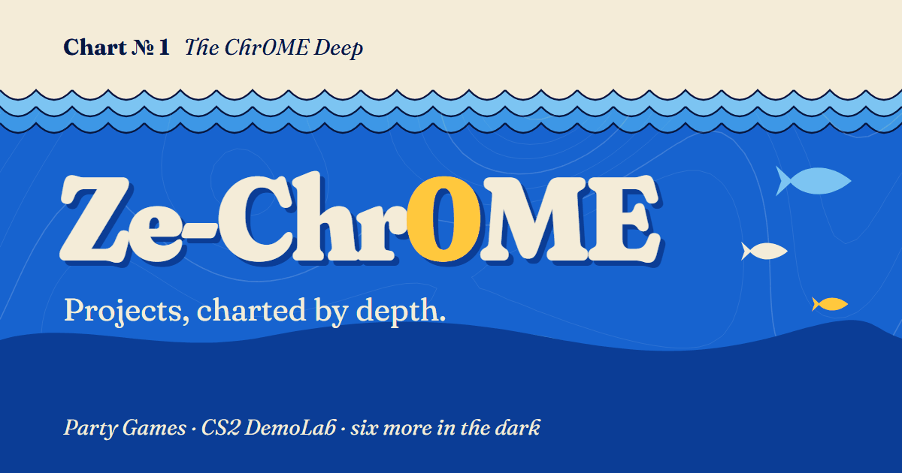

# The Chr0ME Deep

### Projects, charted by depth.

A personal showcase of games, desktop tools and Minecraft mods by [Ze-Chr0ME](https://github.com/Ze-Chr0ME), drawn as a printed ocean chart. Start at the surface, dive past the featured projects, then switch on a lamp to explore the smaller finds below.

**[Dive into the showcase →](https://ze-chr0me.github.io/showcase/)**

[](https://ze-chr0me.github.io/showcase/)

## The dive plan

| Depth | Region | What lives here |
| --- | --- | --- |
| 0 m | Surface | Profile, introduction and navigation |
| 40 m | Safe Shallows | **Party Games** — four browser games sharing one lobby |
| 300 m | Grand Reef | **CS2 DemoLab** — local demo analysis, replays and highlight clips |
| 900 m | Lost River | Six smaller projects, revealed by the anglerfish lamp |
| 1,400 m | Sea floor | Source links and a route back to the surface |

The Lost River features [Filink](https://github.com/Ze-Chr0ME/Filink), [EZDownload](https://github.com/Ze-Chr0ME/EZDownload), [CameraBridge](https://github.com/Ze-Chr0ME/DroidCam), [Cool'n RGB](https://github.com/Ze-Chr0ME/cool-n-rbg), [Everything Backport](https://github.com/Ze-Chr0ME/everything_backport) and [Fabric Skills Mod](https://github.com/Ze-Chr0ME/fabric_skills_mod).

## Drawn like a chart

Cream paper, navy ink and progressively deeper blues set the scene. Contour lines, grain, a compass rose and hand-written SVG sea creatures carry the map theme through the page. DemoLab screenshots sit in tilted, captioned prints alongside the illustrations.

- A scrolling depth gauge tracks the descent.
- An interactive anglerfish lamp reveals the projects in the dark.
- Responsive layouts adapt the chart to phones and desktops.
- Keyboard focus styles, a skip link and reduced-motion support make navigation easier.

## Built with

Plain **HTML, CSS and a small amount of vanilla JavaScript**, hosted on **GitHub Pages**. No framework, package installation or build step.

The page uses Fraunces and Karla from Google Fonts, plus the GitHub profile image. Project screenshots, contour artwork and the social preview image live in this repository.

## Run locally

Clone the repository and open `index.html` in your browser:

```sh
git clone https://github.com/Ze-Chr0ME/showcase.git
cd showcase
```

You can also serve the folder with any static file server. Internet access loads the web fonts and GitHub avatar; the local project content and artwork remain available without them.

## Make changes

| File | Purpose |
| --- | --- |
| [`index.html`](index.html) | Project descriptions, links, inline SVG illustrations and depth-gauge script |
| [`style.css`](style.css) | Colors, typography, chart layout, responsive rules and motion |
| [`assets/`](assets/) | DemoLab screenshots and icon, contour texture and social preview image |

**Update a project:** edit its entry in `index.html`. The featured sections use `#party` and `#demolab`; the smaller projects are listed inside `#deep`.

Each smaller project also has its own static page, styled with the shared `style.css`:

- `filink/`
- `ezdownload/`
- `camerabridge/`
- `cool-n-rgb/`
- `everything-backport/`
- `fabric-skills-mod/`

Edit the corresponding folder's `index.html` to update its field notes. Keep its summary in sync with the main chart. Each page links to its GitHub repository, the other finds and the main chart. Folder URLs work under the GitHub Pages `/showcase/` base path as well as at a domain root, with no build or client-side router. The shared `chart.js` drives the depth gauge on all pages.

**Refresh screenshots:** replace `assets/demolab-overview.jpg`, `assets/demolab-replay.jpg` and `assets/demolab-clips.jpg`. Keep image dimensions, alt text and captions in sync with the new images.

**Adjust the theme:** start with the CSS custom properties in `:root` in `style.css`. Section depths are declared with `data-depth` in the HTML and read by the gauge script.

Before publishing, check the page at desktop and phone widths, follow the project links, and try the lamp and keyboard navigation.

## Publish

GitHub Pages serves the site from the **root of `main`**. Push the updated HTML, CSS and assets to that branch to publish changes; no generated output is needed.

---

Drawn in SVG. No fish were harmed.
